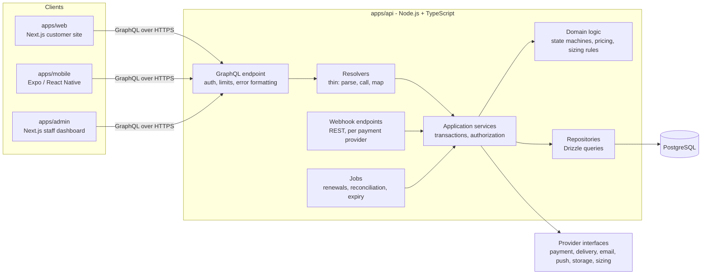

# 1. Architecture

## 1.1 System overview

Bambino is one backend with three clients. There is one database and no microservices.



Request path, as the specification requires:
`GraphQL → resolvers → application services → domain logic → repositories → PostgreSQL`.

| Layer               | Owns                                                                                                              | Must not                                              |
| ------------------- | ----------------------------------------------------------------------------------------------------------------- | ----------------------------------------------------- |
| Resolver            | Reading arguments, calling one service method, shaping the response                                               | Contain rules, query the database, decide permissions |
| Application service | One use case per method, the database transaction, authorization and ownership checks, audit and analytics events | Know about GraphQL or HTTP                            |
| Domain logic        | Pure functions: lifecycles, price calculation, credit calculation, sizing rules                                   | Perform I/O of any kind                               |
| Repository          | SQL through Drizzle; returns plain typed rows                                                                     | Make business decisions                               |
| Provider            | One external system behind an interface                                                                           | Leak provider-specific types past the interface       |

Services named in the specification map one-to-one: `PricingService`, `SubscriptionService`, `SizingService`,
`InventoryService`, `OrderService`, `PaymentService`, `ReturnService`, `ExchangeService`,
`GarmentLifecycleService`, `NotificationService`, plus `AuthService`, `CatalogueService`, `DeliveryService`
and `AuditService`.

## 1.2 Technology decisions

| Area             | Choice                                                                                               | Why                                                                                                                                                |
| ---------------- | ---------------------------------------------------------------------------------------------------- | -------------------------------------------------------------------------------------------------------------------------------------------------- |
| Monorepo         | pnpm workspaces + Turborepo                                                                          | The structure the specification recommends; one lockfile, cached tasks                                                                             |
| Language         | TypeScript (strict, `noUncheckedIndexedAccess`, `exactOptionalPropertyTypes`), `any` is a lint error | Required throughout the stack                                                                                                                      |
| Database         | PostgreSQL only                                                                                      | Every entity is relational and transactional. No requirement justifies MongoDB, so it is not used                                                  |
| Data access      | Drizzle ORM + drizzle-kit SQL migrations                                                             | Schema is TypeScript, migrations are plain reviewable SQL, no query engine binary, and it runs against PGlite for tests                            |
| Test database    | PGlite (PostgreSQL compiled to WASM, in-process)                                                     | Real constraints, triggers and partial indexes in tests with no server to install; CI additionally runs against a real PostgreSQL server (Phase 9) |
| API              | GraphQL, schema-first SDL in `apps/api/src/graphql/schema`                                           | The SDL is the contract shared by three clients; types are generated from it                                                                       |
| GraphQL server   | GraphQL Yoga                                                                                         | Small, standards-compliant, plugin hooks for depth/cost limits and CSRF protection. Added in Phase 3                                               |
| Validation       | Zod schemas in `packages/validation`                                                                 | One definition used by web forms, mobile forms and the API                                                                                         |
| Password hashing | argon2id                                                                                             | Current OWASP first choice                                                                                                                         |
| Background jobs  | pg-boss (queue stored in PostgreSQL)                                                                 | Renewals and reconciliation need durable jobs; this adds no infrastructure. Added in Phase 5                                                       |
| Web              | Next.js App Router, React, Tailwind CSS, TanStack Query                                              | As specified. Public pages server-rendered for SEO; account pages client-rendered                                                                  |
| Admin            | Separate Next.js app served under `/admin` (`basePath`)                                              | Separate bundle and deployment, so staff code never ships to customers                                                                             |
| Mobile           | Expo + React Native + Expo Router + TanStack Query                                                   | As specified; persisted query cache for offline reads                                                                                              |
| Styling          | Tailwind only (NativeWind on mobile)                                                                 | One system. No SCSS or styled-components: nothing requires them                                                                                    |
| Firebase         | Push notifications only (FCM), in P1                                                                 | The single place it adds value. No transactional data is copied to it                                                                              |
| Object storage   | Any S3-compatible service through one provider; RustFS in Docker for development                     | Clients upload directly with signed URLs; no SDK dependency (AWS Signature V4 implemented and tested in-house)                                     |
| Local services   | Docker Compose: PostgreSQL 18 and RustFS                                                             | Same database engine as production; MinIO no longer publishes free images                                                                          |
| Tests            | Vitest (unit and integration), Playwright (web E2E)                                                  | Fast, TypeScript-native                                                                                                                            |

Pinned in this phase: TypeScript 6.0. TypeScript 7 is installed by default but typescript-eslint does not
support it yet (`<6.1.0`), and losing lint coverage is not worth the newer compiler.

## 1.3 Monorepo structure

```
bambino/
├── apps/
│   ├── api/            GraphQL API, services, domain logic, jobs, webhooks
│   ├── web/            customer website                          (Phase 6)
│   ├── mobile/         Expo app                                  (Phase 7)
│   └── admin/          staff dashboard                           (Phase 8)
├── packages/
│   ├── types/          enums and the RBAC catalogue: the shared vocabulary
│   ├── utils/          money arithmetic and formatting
│   ├── config/         per-market configuration (Rwanda today)
│   ├── validation/     Zod schemas                               (Phase 3)
│   ├── api-client/     typed GraphQL operations + fetch client   (Phase 6)
│   └── ui/             design tokens + web components            (Phase 2)
├── database/           Drizzle schema, SQL migrations, seeds
├── tests/              cross-app end-to-end journeys             (Phase 9)
└── docs/
```

Only directories with real content exist today. The ones marked with a phase are created when that phase
starts, so the repository never contains empty shells that look like progress.

Internal packages export TypeScript source directly (`"exports": "./src/index.ts"`). There is no build step
between packages: Next.js, Metro, Vitest and the API runtime all compile them on demand.

## 1.4 Single sources of truth

| Fact                                | Defined once in                         | Consumers                                            | Guard                                                                                            |
| ----------------------------------- | --------------------------------------- | ---------------------------------------------------- | ------------------------------------------------------------------------------------------------ |
| Status values                       | `packages/types/src/enums.ts`           | PostgreSQL enums, GraphQL enums, state machines      | Tests compare GraphQL enums and state machines to these arrays; PG enums are generated from them |
| Permissions and default role grants | `packages/types/src/rbac.ts`            | Seeds, `@requires` directives, admin UI              | Test: every `@requires` names a known permission                                                 |
| Allowed status transitions          | `apps/api/src/domain/lifecycles.ts`     | Every service that changes a status                  | Unit tests per lifecycle                                                                         |
| Table structure                     | `database/src/schema/*`                 | Migrations, repositories                             | Migrations are generated from it and applied in tests                                            |
| API contract                        | `apps/api/src/graphql/schema/*.graphql` | Resolvers, `packages/api-client`                     | Test: every operation in the specification exists                                                |
| Country differences                 | `packages/config/src/markets.ts`        | Pricing, checkout, address forms, provider selection | Consistency tests per market                                                                     |

## 1.5 Provider abstractions

Every external system is reached through an interface with a development implementation, selected by
environment configuration. Business logic depends on the interface only.

| Interface          | Implementations                                                                        | Status                                                                                     |
| ------------------ | -------------------------------------------------------------------------------------- | ------------------------------------------------------------------------------------------ |
| `PaymentProvider`  | `MockPaymentProvider`, `MtnMomoProvider`, `AirtelMoneyProvider`, later a card provider | Phase 4. Mock first; MTN and Airtel are NOT YET INTEGRATED until sandbox credentials exist |
| `SizingProvider`   | `RulesBasedSizingProvider`, later `MLSizingProvider`                                   | Phase 5. Rules only; nothing is labelled AI                                                |
| `DeliveryProvider` | `InHouseDeliveryProvider` (staff update status by hand)                                | Phase 4                                                                                    |
| `EmailProvider`    | `ConsoleEmailProvider` (logs the message), real provider to be chosen                  | Phase 3, MOCKED until a provider is chosen                                                 |
| `PushProvider`     | none yet, FCM later                                                                    | P1                                                                                         |
| `StorageProvider`  | `LocalStorageProvider`, S3-compatible later                                            | Phase 4                                                                                    |

See [04-payments.md](04-payments.md) and [05-lifecycles.md](05-lifecycles.md#sizing-engine) for the two that
carry the most design.

## 1.6 Money

- Amounts are integers in the currency's minor unit, in `bigint` columns, always paired with a currency code.
  RWF has no minor unit, so RWF 10,500 is `10500`.
- `packages/utils/src/money.ts` is the only place arithmetic on money happens. It rejects non-integers and
  mixed currencies, and computes percentages in basis points with BigInt intermediates.
- GraphQL exposes amounts through the `MinorUnits` scalar (a JSON integer that may exceed 32 bits).
- Customers can never send an amount: a contract test fails if any customer mutation accepts `MinorUnits`.
- The database re-checks arithmetic: `orders.total = subtotal − discount − credit + shipping + tax` and
  `order_items.line_total = unit_price × quantity` are CHECK constraints.

## 1.7 Internationalisation and markets

- User-facing text is never stored in components or returned by the API as English sentences. Clients hold
  translation files keyed by message id; the API returns keys and parameters (for example sizing reasons and
  notifications), and error codes rather than prose.
- English ships first. The locale list already contains `rw`, `fr` and `sw`; adding a language is adding a
  translation file and listing it in the market's `supportedLocales`.
- `MarketConfig` holds country, currency, locales, timezone, payment providers, delivery providers, tax rule
  and address format. Rwanda is the only entry. A second country is a new entry plus its plans, delivery
  options and prices in the database.

## 1.8 Errors and observability

- Domain and service errors carry a stable `code`. The GraphQL error formatter maps them to
  `extensions.code` (`UNAUTHENTICATED`, `FORBIDDEN`, `NOT_FOUND`, `VALIDATION_FAILED`, `CONFLICT`,
  `RATE_LIMITED`, `PAYMENT_FAILED`, `INTERNAL`) and a `requestId`. Unknown errors become `INTERNAL` with no
  detail; stack traces and provider messages stay in the server log.
- Every request gets a request id, attached to logs, audit entries and the error response.
- Structured JSON logs. Wallet numbers and tokens are redacted before logging.
- Clients show a translated message per code, with React error boundaries as the last resort.

## 1.9 Notifications and analytics

- `NotificationService.notify(userId, type, params)` writes one row per enabled channel and hands each to its
  channel provider. In-app works as soon as the row exists; email is mocked; push arrives in P1.
- `AnalyticsService.track(event, userId, properties)` writes to `analytics_events`. Properties are ids and
  categories only. Admin metrics are computed from transactional tables, never from hard-coded numbers.

## 1.10 Privacy

- A baby profile holds a nickname, date of birth, optional sex, measurements and fit preferences. Nothing else
  is collected about a child.
- Every customer query is scoped by the signed-in user's id inside the repository call, so an id belonging to
  someone else returns "not found" rather than data.
- Consent is recorded per document version at registration.
- Account deletion is a workflow (`data_requests`): active subscriptions and outstanding garments are settled
  first, then personal fields are removed or replaced in place. Orders and payments are kept without personal
  details because financial records must survive.
- Data export is the same workflow producing a file in object storage.
