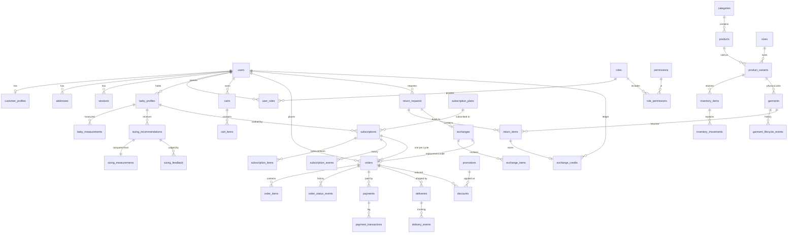

# 2. Data model

The executable definition is `database/src/schema/`. The SQL that creates it is
`database/migrations/0000_initial_schema.sql` (generated) and `0001_integrity_triggers.sql` (hand-written).
This page explains the shape and the decisions; it does not repeat every column.

55 tables. The specification names 34 entities; the other 21 are what those entities need in order to be
correct (sessions, ledgers, event histories, idempotency, consent).

## 2.1 Conventions

| Rule              | Detail                                                                                            |
| ----------------- | ------------------------------------------------------------------------------------------------- |
| Primary keys      | `uuid`, generated by the database                                                                 |
| Time              | `timestamptz` everywhere; `created_at` on every table, `updated_at` where rows change             |
| Money             | `bigint` minor units + `currency char(3)`; see [architecture §1.6](01-architecture.md#16-money)   |
| Measurements      | Integers: millimetres and grams. No floating-point columns exist                                  |
| Closed value sets | PostgreSQL enums generated from `@bambino/types`                                                  |
| Soft deletion     | `deleted_at` on users, addresses, baby profiles, products, payment methods                        |
| History           | Separate append-only event tables; the current state lives on the parent row                      |
| Snapshots         | Orders copy product name, SKU, size, price and address, so later edits never rewrite a past order |

## 2.2 Entity relationships

Not drawn, to keep the diagram readable: `verification_tokens`, `consent_records`, `data_requests`,
`media_assets`, `product_images`, `return_item_media`, `subscription_plan_categories`, `payment_methods`,
`delivery_options`, `webhook_events`, `idempotency_keys`, `notifications`, `audit_logs`, `analytics_events`.

## 2.3 Decisions worth knowing

**Two kinds of stock.** `inventory_items` counts brand-new units per variant and location, for sale.
`garments` has one row per physical unit in the circular pool, each with a tag code. A unit enters the pool by
being registered as a garment. This keeps counting cheap where identity does not matter and exact where it
does. Whether one-time purchases can later be returned for credit is an open business question
([08](08-open-questions.md)); the model supports either answer because `order_items.garment_id` is optional.

**`Promotion` and `Discount`.** A promotion is the rule (code, type, limits, dates). A discount is one
application of it to one order or subscription. Redemption limits are enforced by counting discounts inside
the checkout transaction.

**`BabyMeasurement` and `SizingMeasurement`.** The first is the baby's growth history and can be corrected.
The second is a frozen copy of exactly what a recommendation was computed from, paired with
`sizing_feedback` on how that size fitted. Together they are the input and outcome columns of a future
training set, which is why they are never updated.

**Exchange credit is a ledger.** `exchange_credits` holds signed entries (`EARNED`, `REDEEMED`, `EXPIRED`,
`ADJUSTMENT`). The balance is their sum. There is no balance column to drift or be edited.

**Roles are data.** `roles`, `permissions` and `role_permissions` are seeded from `@bambino/types` and can be
extended in the admin UI. Code checks permissions, never role names.

**Market scoping.** `customer_profiles`, `subscription_plans` and `delivery_options` carry a `market_code`.
The market's fixed properties live in `packages/config`, not in a table, because they change with a release,
not at runtime.

## 2.4 Integrity enforced by the database

These hold even if application code has a bug. Each is covered by a test in `database/src/schema.test.ts`.

| Protection                                 | Mechanism                                                                                                                                                              |
| ------------------------------------------ | ---------------------------------------------------------------------------------------------------------------------------------------------------------------------- |
| No duplicate account by email case         | Unique index on `lower(email)`                                                                                                                                         |
| Duplicate checkout submission              | Unique `(user_id, idempotency_key)` on orders                                                                                                                          |
| Tampered order total                       | CHECK: total equals its parts; all parts non-negative                                                                                                                  |
| Tampered line total                        | CHECK: `line_total = unit_price × quantity`                                                                                                                            |
| Double charge                              | Partial unique index: one `SUCCEEDED` payment per order                                                                                                                |
| Payment replay                             | Unique `idempotency_key` on payments; unique `(provider, provider_reference)`                                                                                          |
| Webhook replay                             | Unique `(provider, provider_event_id)` on webhook events                                                                                                               |
| Overselling                                | CHECK: `0 ≤ reserved ≤ on_hand`                                                                                                                                        |
| Two live subscriptions for one baby        | Partial unique index on live statuses                                                                                                                                  |
| Two active carts                           | Partial unique index                                                                                                                                                   |
| Coupon replay on an order                  | Unique `(promotion_id, order_id)`                                                                                                                                      |
| Credit issued twice for one garment        | Partial unique index on `EARNED` per return item                                                                                                                       |
| Credit spent twice on one order            | Partial unique index on `REDEEMED` per order                                                                                                                           |
| Wrong-signed credit entry                  | CHECK on sign per entry type                                                                                                                                           |
| Inspection outcome without inspection      | CHECK on return items                                                                                                                                                  |
| Garment "with customer" without a customer | CHECK                                                                                                                                                                  |
| Rewriting history                          | Trigger blocks UPDATE and DELETE on `garment_lifecycle_events`, `audit_logs`, `payment_transactions`, `exchange_credits`, `inventory_movements`, `subscription_events` |
| Deleting a garment                         | Trigger blocks DELETE on `garments`                                                                                                                                    |

Status transitions are enforced in the service layer by the state machines, not by the database, because
the allowed moves depend on context the database does not have.

## 2.5 Indexing

Every foreign key used for lookup is indexed. Partial indexes serve the three recurring jobs directly:
subscriptions due for renewal, payments still unresolved, webhook events not yet processed. Catalogue
filtering uses indexes on category, size and price; full-text search on product name and description is
added with the catalogue queries in Phase 4, when the actual query shape is known.

## 2.6 Changing the schema

1. Edit `database/src/schema/*`.
2. `pnpm db:generate` writes a new SQL migration.
3. Review the SQL, then run the tests, which apply every migration to a fresh database.

Migrations are append-only once they have been applied to any shared environment.
