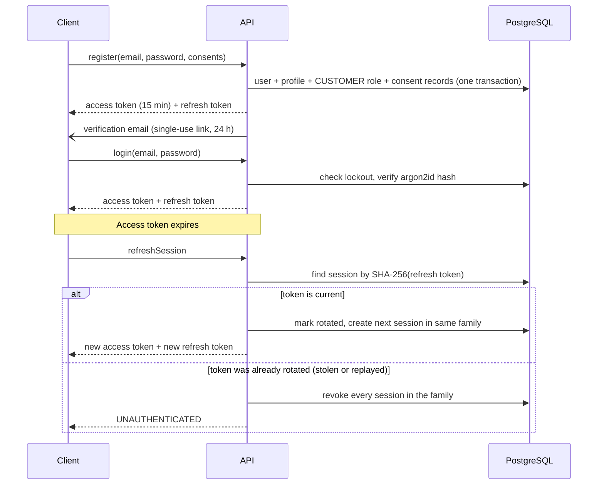

# 3. Authentication, authorization and security model

Status: designed. The tables and the permission catalogue exist and are tested; the auth service itself is
built in Phase 3.

## 3.1 Authentication flow

| Element                            | Design                                                                                                                                   |
| ---------------------------------- | ---------------------------------------------------------------------------------------------------------------------------------------- |
| Password storage                   | argon2id hash only. Minimum length 10, checked against a common-password list                                                            |
| Access token                       | Signed JWT, 15 minutes, carries user id and session id. Permissions are loaded per request, so a role change takes effect immediately    |
| Refresh token                      | 256 random bits, opaque. Only its SHA-256 is stored. Rotated on every use, with reuse detection                                          |
| Web transport                      | Both tokens in `httpOnly`, `Secure`, `SameSite=Lax` cookies. JavaScript never sees them                                                  |
| Mobile transport                   | Tokens in the response body, kept in the device keystore (`expo-secure-store`), sent as `Authorization: Bearer`                          |
| Email verification, password reset | Single-use random tokens, stored hashed, with expiry (24 h and 1 h). Reset revokes all sessions                                          |
| Brute force                        | Per-IP and per-account rate limits; after 5 consecutive failures the account locks for 15 minutes (`failed_login_count`, `locked_until`) |
| Enumeration                        | Login and password-reset responses are identical whether or not the account exists                                                       |
| Phone sign-in                      | Schema supports it (`phone`, `PHONE_OTP` tokens). NOT YET INTEGRATED: needs an SMS provider                                              |

## 3.2 Authorization

Two independent checks, both on the server:

1. **Permission**, for staff operations. The contract declares it (`@requires(permission: "return:write")`);
   the service method enforces it. 30 permissions, 8 seeded roles, all in `packages/types/src/rbac.ts`.
2. **Ownership**, for customer operations. Every repository call for customer data takes the signed-in user id
   as a filter. A valid id belonging to another customer returns `NOT_FOUND`, which prevents IDOR and avoids
   confirming that the record exists.

Client-side route guards exist only for navigation. They are never relied on.

| Role                 | Summary of default grants                                                           |
| -------------------- | ----------------------------------------------------------------------------------- |
| `SUPER_ADMIN`        | Everything                                                                          |
| `OPERATIONS_MANAGER` | Orders, subscriptions, returns, exchanges, deliveries, garments, inventory, reports |
| `INVENTORY_MANAGER`  | Inventory, garments, return inspection                                              |
| `CUSTOMER_SUPPORT`   | Read customers, orders, payments; act on returns and exchanges                      |
| `DELIVERY_STAFF`     | Read orders; update deliveries                                                      |
| `FINANCE`            | Payments (including reconciliation), reports                                        |
| `CONTENT_MANAGER`    | Products, promotions, notifications                                                 |
| `CUSTOMER`           | No staff permissions                                                                |

A test asserts that only `SUPER_ADMIN` and `FINANCE` can write payments and only `SUPER_ADMIN` can change
roles.

## 3.3 Threat model

| Threat                             | Control                                                                                                                                                                                     | Where                     |
| ---------------------------------- | ------------------------------------------------------------------------------------------------------------------------------------------------------------------------------------------- | ------------------------- |
| SQL injection                      | Parameterised queries only, through Drizzle. No string-built SQL                                                                                                                            | Repositories              |
| NoSQL injection                    | Not applicable: no document database                                                                                                                                                        |                           |
| XSS                                | React escapes output; no `dangerouslySetInnerHTML` for user content; Content-Security-Policy header; tokens in `httpOnly` cookies                                                           | Web, admin                |
| CSRF                               | `SameSite=Lax` cookies, plus the API rejects cookie-authenticated requests lacking a custom header and JSON content type                                                                    | API                       |
| GraphQL abuse                      | Depth limit, cost limit, page-size caps, introspection off in production, batching off                                                                                                      | API                       |
| Brute force                        | Rate limits and account lockout (3.1)                                                                                                                                                       | Auth service              |
| Broken access control, IDOR        | Permission and ownership checks in services (3.2); contract test that every non-public operation declares a guard                                                                           | Services                  |
| Mass assignment                    | Inputs are explicit GraphQL input types validated by Zod; services copy named fields only. No input type contains role, status or price fields                                              | API                       |
| Price manipulation                 | No customer mutation accepts an amount (contract test). Totals are recomputed from database prices at checkout and again verified by CHECK constraints                                      | Pricing service, database |
| Coupon manipulation                | Code validated server-side for dates, scope, minimum and limits; redemptions counted in the checkout transaction; unique per order                                                          | Pricing service, database |
| Duplicate orders                   | Idempotency key per checkout, unique per user                                                                                                                                               | Order service, database   |
| Duplicate payments, payment replay | Idempotency key is the provider request reference; one successful payment per order                                                                                                         | Payment service, database |
| Webhook replay or forgery          | Signature or shared-secret check where the provider offers one; event stored under a unique key; the payment status is then fetched from the provider's API and only that answer is trusted | Webhook handler           |
| Secrets exposure                   | Secrets only in environment variables, validated at startup; production refuses to start with a missing value or a placeholder. Payment keys exist only in `apps/api`                       | Configuration             |
| Tampering with records             | Append-only tables guarded by triggers; audit log of price, inventory, subscription, payment, return, exchange and role changes                                                             | Database, audit service   |
| Exposure of child data             | Minimal collection, ownership scoping, staff access limited by `baby_profile:read` and audited                                                                                              | Services                  |

Also applied: security headers (HSTS, `X-Content-Type-Options`, `Referrer-Policy`, frame denial), a CORS
allow-list of the web and admin origins, and `noindex` on all account and admin pages.
