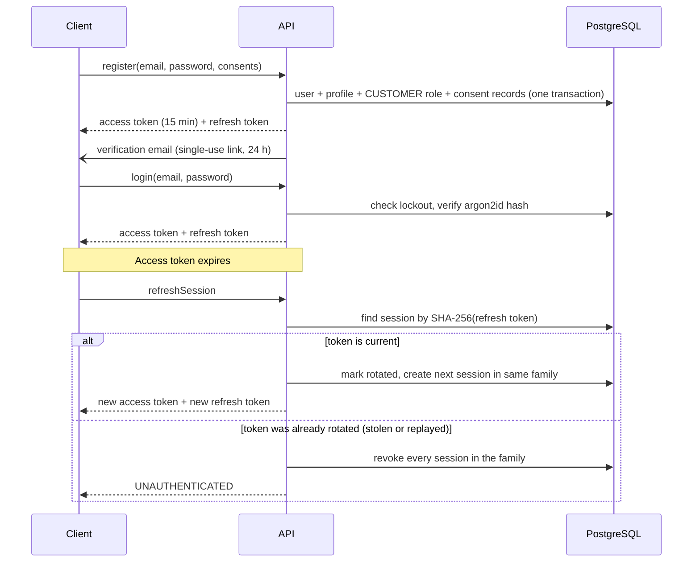

# 3. Authentication, authorization and security model

Status: designed. The tables and the permission catalogue exist and are tested; the auth service itself is
built in Phase 3.

## 3.1 Authentication flow

| Element                            | Design                                                                                                                                   |
| ---------------------------------- | ---------------------------------------------------------------------------------------------------------------------------------------- |
| Password storage                   | argon2id hash only. Minimum length 10, checked against a common-password list                                                            |
| Access token                       | Signed JWT, 15 minutes, carries user id and session id. Permissions are loaded per request, so a role change takes effect immediately    |
| Refresh token                      | 256 random bits, opaque. Only its SHA-256 is stored. Rotated on every use, with reuse detection                                          |
| Web transport                      | Both tokens in `httpOnly`, `Secure`, `SameSite=Lax` cookies. JavaScript never sees them                                                  |
| Mobile transport                   | Tokens in the response body, kept in the device keystore (`expo-secure-store`), sent as `Authorization: Bearer`                          |
| Email verification, password reset | Single-use random tokens, stored hashed, with expiry (24 h and 1 h). Reset revokes all sessions                                          |
| Brute force                        | Per-IP and per-account rate limits; after 5 consecutive failures the account locks for 15 minutes (`failed_login_count`, `locked_until`) |
| Enumeration                        | Login and password-reset responses are identical whether or not the account exists                                                       |
| Phone sign-in                      | Schema supports it (`phone`, `PHONE_OTP` tokens). NOT YET INTEGRATED: needs an SMS provider                                              |

## 3.2 Authorization

Two independent checks, both on the server:

1. **Permission**, for staff operations. The contract declares it (`@requires(permission: "return:write")`);
   the service method enforces it. 30 permissions, 8 seeded roles, all in `packages/types/src/rbac.ts`.
2. **Ownership**, for customer operations. Every repository call for customer data takes the signed-in user id
   as a filter. A valid id belonging to another customer returns `NOT_FOUND`, which prevents IDOR and avoids
   confirming that the record exists.

Client-side route guards exist only for navigation. They are never relied on.

| Role                 | Summary of default grants                                                           |
| -------------------- | ----------------------------------------------------------------------------------- |
| `SUPER_ADMIN`        | Everything                                                                          |
| `OPERATIONS_MANAGER` | Orders, subscriptions, returns, exchanges, deliveries, garments, inventory, reports |
| `INVENTORY_MANAGER`  | Inventory, garments, return inspection                                              |
| `CUSTOMER_SUPPORT`   | Read customers, orders, payments; act on returns and exchanges                      |
| `DELIVERY_STAFF`     | Read orders; update deliveries                                                      |
| `FINANCE`            | Payments (including reconciliation), reports                                        |
| `CONTENT_MANAGER`    | Products, promotions, notifications                                                 |
| `CUSTOMER`           | No staff permissions                                                                |

A test asserts that only `SUPER_ADMIN` and `FINANCE` can write payments and only `SUPER_ADMIN` can change
roles.

## 3.3 Threat model

| Threat                             | Control                                                                                                                                                                                     | Where                     |
| ---------------------------------- | ------------------------------------------------------------------------------------------------------------------------------------------------------------------------------------------- | ------------------------- |
| SQL injection                      | Parameterised queries only, through Drizzle. No string-built SQL                                                                                                                            | Repositories              |
| NoSQL injection                    | Not applicable: no document database                                                                                                                                                        |                           |
| XSS                                | React escapes output; no `dangerouslySetInnerHTML` for user content; Content-Security-Policy header; tokens in `httpOnly` cookies                                                           | Web, admin                |
| CSRF                               | `SameSite=Lax` cookies, plus the API rejects cookie-authenticated requests lacking a custom header and JSON content type                                                                    | API                       |
| GraphQL abuse                      | Depth limit, cost limit, page-size caps, introspection off in production, batching off                                                                                                      | API                       |
| Brute force                        | Rate limits and account lockout (3.1)                                                                                                                                                       | Auth service              |
| Broken access control, IDOR        | Permission and ownership checks in services (3.2); contract test that every non-public operation declares a guard                                                                           | Services                  |
| Mass assignment                    | Inputs are explicit GraphQL input types validated by Zod; services copy named fields only. No input type contains role, status or price fields                                              | API                       |
| Price manipulation                 | No customer mutation accepts an amount (contract test). Totals are recomputed from database prices at checkout and again verified by CHECK constraints                                      | Pricing service, database |
| Coupon manipulation                | Code validated server-side for dates, scope, minimum and limits; redemptions counted in the checkout transaction; unique per order                                                          | Pricing service, database |
| Duplicate orders                   | Idempotency key per checkout, unique per user                                                                                                                                               | Order service, database   |
| Duplicate payments, payment replay | Idempotency key is the provider request reference; one successful payment per order                                                                                                         | Payment service, database |
| Webhook replay or forgery          | Signature or shared-secret check where the provider offers one; event stored under a unique key; the payment status is then fetched from the provider's API and only that answer is trusted | Webhook handler           |
| Secrets exposure                   | Secrets only in environment variables, validated at startup; production refuses to start with a missing value or a placeholder. Payment keys exist only in `apps/api`                       | Configuration             |
| Tampering with records             | Append-only tables guarded by triggers; audit log of price, inventory, subscription, payment, return, exchange and role changes                                                             | Database, audit service   |
| Exposure of child data             | Minimal collection, ownership scoping, staff access limited by `baby_profile:read` and audited                                                                                              | Services                  |

Also applied: security headers (HSTS, `X-Content-Type-Options`, `Referrer-Policy`, frame denial), a CORS
allow-list of the web and admin origins, and `noindex` on all account and admin pages.

## 3.4 Personal data: export and deletion

Rwanda's data protection law (Law 058/2021) gives parents the right to a copy of their data and to have it erased.
Children's data is treated with extra care. Both requests start from the account page and are carried out by the
API's background job (`PrivacyService`, run with payment reconciliation). The timings below are placeholders until
the business decides (open question 14, `PRIVACY_POLICY` in `packages/config/src/policies.ts`).

### Export

- Builds one JSON file with everything held about the account: account and profile, addresses, consents, babies,
  measurements and size recommendations, subscriptions, orders and items, payments, refunds, saved wallets,
  returns, exchanges, exchange credit, notifications, data requests, and audit entries about or by the account.
  Password hashes, token hashes and staff-only refund reasons are left out.
- Stored privately (`private/exports/…`, outside the public-read prefixes) and kept for
  `exportRetentionDays` (7), then deleted.
- The email says the file is ready and links to the account page. It contains no data and no download link. After
  signing in, the parent gets a signed link valid for `exportLinkMinutes` (15).

### Deletion

Carried out `deletionGraceDays` (14) after the request. The account is anonymised in place: its row and id stay,
so records that must be kept still point somewhere, but nothing in them identifies the person. Running it twice
is harmless.

| Data                                                                      | What happens                                                     | Why                                                                                                                     |
| ------------------------------------------------------------------------- | ---------------------------------------------------------------- | ----------------------------------------------------------------------------------------------------------------------- |
| Email, phone, password, verification, sign-in state                       | Removed; status `DELETED`. Sessions, tokens and roles deleted    | The person can no longer sign in or be contacted                                                                        |
| Name (customer profile)                                                   | Replaced with "Deleted customer"                                 | Personal data                                                                                                           |
| Addresses                                                                 | Name, phone, street, sector and directions removed; soft-deleted | Personal data                                                                                                           |
| Address copies on orders and deliveries                                   | Same fields removed; country, province and district kept         | Orders are accounting records; district-level location is not identifying and supports delivery and tax reporting       |
| Baby profiles                                                             | Name, birth date, sex, preferences and current size removed      | Children's data                                                                                                         |
| Baby measurements, size recommendations and their inputs and fit feedback | Deleted                                                          | Children's data; the recommendation inputs are measurements                                                             |
| Saved wallets; the wallet number on payments                              | Removed                                                          | Personal data                                                                                                           |
| Orders, order items, payments, payment and refund records                 | Kept, linked to the anonymised account                           | Accounting and tax records must be kept (retention period: open question 14)                                            |
| Exchange credit ledger, subscription and order history                    | Kept, linked to the anonymised account                           | Financial history; append-only by design                                                                                |
| Garment lifecycle history                                                 | Kept unchanged                                                   | It records the garment's life, not the person; it now points at an anonymised account                                   |
| Consent records                                                           | Kept; IP address removed                                         | Evidence that past processing had consent                                                                               |
| Audit log                                                                 | Kept unchanged                                                   | Security record, append-only. It holds IP addresses and user agents; their retention period is part of open question 14 |
| Notifications, cart items                                                 | Deleted                                                          | No reason to keep                                                                                                       |
| Analytics events                                                          | Kept, with the link to the account removed                       | Aggregate reporting only                                                                                                |
| Export files                                                              | Deleted                                                          | Personal data                                                                                                           |

Before anonymising, unpaid orders and live subscriptions are cancelled. Known limitation: an order still on its
way loses the recipient's name, phone and street when deletion runs, so staff should deliver or cancel open orders
during the grace period. Postponing deletion until open deliveries finish is a possible follow-up.
