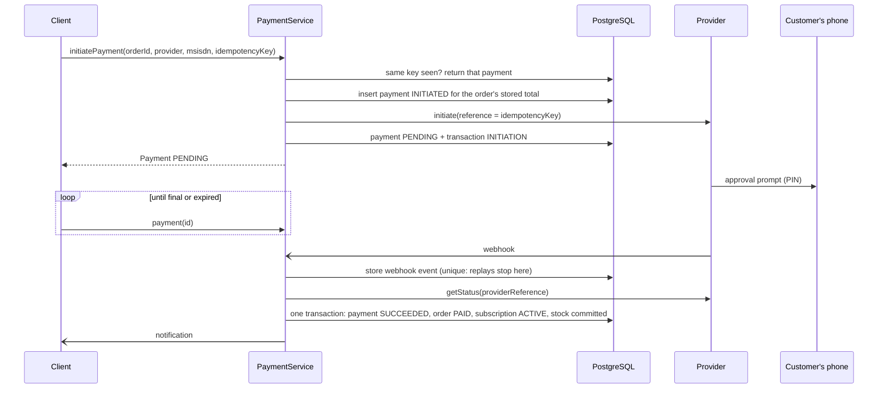
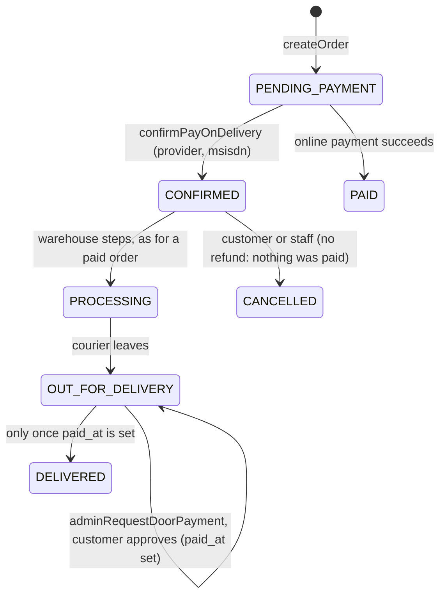

# 4. Payment architecture

Status: designed. Tables, the payment lifecycle and their tests exist. The payment service and the mock
provider are built in Phase 4. MTN MoMo (Collections and Disbursement refunds) is built against MTN's documented API and unit tested with a
scripted MTN, but has **not yet been run against the MTN sandbox**: that needs your credentials (section 4.6).
Airtel Money is NOT YET INTEGRATED. Provider details below must be confirmed against each provider's current
documentation.

## 4.1 Interface

```ts
interface PaymentProvider {
  readonly code: PaymentProviderCode;
  /** Ask the provider to collect. Returns once the request is accepted, not once it is paid. */
  initiate(request: {
    reference: string; // our payment's idempotency key
    amount: Money;
    payerMsisdn: string;
    description: string;
  }): Promise<{ providerReference: string; expiresAt: Date | null }>;
  /** The provider's current answer for a payment. The only source of a final status. */
  getStatus(
    providerReference: string,
  ): Promise<{ status: 'PENDING' | 'SUCCEEDED' | 'FAILED'; failureCode?: string }>;
  /** Authenticate an incoming webhook and extract which payment it concerns. */
  parseWebhook(
    headers: Headers,
    body: string,
  ): { eventId: string; providerReference: string; signatureValid: boolean };
}
```

`MockPaymentProvider` implements the same interface for development and tests. Its outcome is chosen by the
test or by the wallet number used (one number approves, one declines, one never answers), so success is
never hard-coded and the failure and timeout paths are exercised. It is rejected in production.

## 4.2 Flow



Rules:

1. The amount is read from the order row. The client supplies no amount.
2. A payment becomes `SUCCEEDED` only from `getStatus`, reached by webhook, by polling or by reconciliation.
   The webhook body is a trigger to go and check, not evidence.
3. Applying a final status and its consequences (order paid, subscription activated, stock committed, credit
   redeemed) is one database transaction guarded by the payment lifecycle, so applying the same result twice
   changes nothing.
4. Every provider interaction appends a `payment_transactions` row.
5. Failure messages shown to customers are our own translated text per failure code.

## 4.3 Reconciliation

A job looks for payments still `INITIATED` or `PENDING` past a short grace period (there is a partial index
for exactly this), asks the provider for each one's status and applies it. Payments past their expiry with
no answer become `EXPIRED` and release reserved stock. Staff can trigger the same check for one payment
(`adminReconcilePayment`); there is no operation that sets a payment's status by hand.

## 4.4 Recurring billing with mobile money

Mobile money collections are approved by the customer on their phone each time. Bambino holds no credential
that allows charging a wallet silently, so "renewal" means:

1. A reminder notification before the period ends.
2. On the billing date, a renewal order is created and a collection request is sent to the saved wallet.
3. Approved: the period advances. Declined or unanswered: the subscription becomes `PAST_DUE`, with retries
   on a configurable schedule and a "pay now" action in the app, then `EXPIRED`.

The subscription lifecycle and the renewal job are provider-independent, so a provider offering pre-approved
debits, or cards, changes only the provider implementation.

## 4.4a Pay on delivery (mobile money at the door, no cash)

Status: implemented. The customer chooses a wallet when confirming; nothing is charged then. When the order is out for
delivery and the courier is at the door, staff ask for payment and the customer approves a mobile-money request on their
phone. There is **no cash** anywhere in the flow. The retired provider code `CASH_ON_DELIVERY` is refused.



1. `confirmPayOnDelivery(orderId, provider, msisdn)` runs in one transaction: the order moves `PENDING_PAYMENT` to
   `CONFIRMED` and stores the wallet (`pay_on_delivery_provider`, `pay_on_delivery_msisdn`), stock is committed, the
   delivery is created and the customer is told. No payment row exists yet. It is idempotent by state. The provider
   must be integrated and offered (`PaymentService.doorProviders`).
2. `CONFIRMED` means "accepted, money due at the door". `PAID` keeps meaning "money received".
3. `adminRequestDoorPayment(orderId)` (permission `order:write`, order `OUT_FOR_DELIVERY`) creates a normal payment
   for the order total and asks the stored wallet. Repeating it returns the open request; after a decline a new
   request can be made. The customer's screen polls and shows an "approve on your phone" prompt.
4. When the payment succeeds, only `orders.paid_at` is set; the status stays `OUT_FOR_DELIVERY`. Moving to `DELIVERED`
   without payment fails with `DOOR_PAYMENT_NOT_COLLECTED`.
5. Cancelling before delivery restocks, returns credit and any coupon, and closes open payments. No refund is needed
   because nothing was taken. A confirmed door order is never cancelled by the unpaid-order cleanup.
6. Eligibility is `PAY_ON_DELIVERY_POLICY` (packages/config): shop orders only, no limit at present. Subscription
   orders keep requiring a wallet that can be charged again. The rule is shown at checkout and enforced again on
   confirmation.

Known limits, listed in open question 15: a customer whose phone is off or who declines at the door leaves the order
undelivered (the courier brings it back); there is no deposit for first-time customers.

## 4.6 MTN MoMo: switching it on

Implemented in `apps/api/src/providers/mtn-momo.ts`. How it behaves:

- `requesttopay` asks the payer's wallet; the customer approves with their PIN. Our reference becomes MTN's
  `X-Reference-Id` through a stable UUID, so a repeat is a 409 that we treat as the same request.
- **Status is polled, never pushed.** MTN callbacks carry no signature, so `parseWebhook` refuses them. The
  reconciliation job and the customer's own status checks ask MTN directly.
- Refunds use Disbursement `refund` and need the second set of keys; without them a refund is refused.
- The sandbox accepts EUR only (`MTN_MOMO_CURRENCY=EUR`); production uses RWF and the live host and target
  environment name MTN assigns. The API refuses the sandbox host in production.

To try it in the sandbox:

1. Create an account at momodeveloper.mtn.com and subscribe to the **Collection** product (and **Disbursement** for
   refunds). Copy each product's primary key (the subscription key).
2. Create an API user and key for each product (the portal's sandbox provisioning calls, or the API: `POST
/v1_0/apiuser` then `POST /v1_0/apiuser/{id}/apikey`).
3. Set, per environment, with `wrangler secret put`: `MTN_MOMO_COLLECTION_SUBSCRIPTION_KEY`,
   `MTN_MOMO_COLLECTION_API_USER`, `MTN_MOMO_COLLECTION_API_KEY` (and the three `MTN_MOMO_DISBURSEMENT_*`), then set
   `PAYMENT_PROVIDERS_ENABLED=mock,mtn_momo` and `MTN_MOMO_CURRENCY=EUR` in `wrangler.jsonc`.
4. Redeploy the API. In the sandbox, test numbers decide the outcome (46733123450 approves, 46733123451 rejects,
   46733123452 times out; check the portal's current list).
5. For production: the live host, `MTN_MOMO_TARGET_ENVIRONMENT`, `MTN_MOMO_CURRENCY=RWF`, `PAYMENT_METHODS` listing
   `MTN MoMo` so the home page names it, and a real small payment and refund before launch.

## 4.5 Provider notes to verify at integration time

|                          | MTN MoMo (Collections)                                                                           | Airtel Money (Collections)                                              |
| ------------------------ | ------------------------------------------------------------------------------------------------ | ----------------------------------------------------------------------- |
| Expected model           | Request-to-pay with a caller-supplied UUID reference; status by reference; optional callback URL | Payment request with OAuth client credentials; status enquiry; callback |
| Our reference            | `payments.idempotency_key`                                                                       | `payments.idempotency_key`                                              |
| Needed from the business | Merchant account, API user and key, subscription key, sandbox access                             | Merchant account, client id and secret, sandbox access                  |
