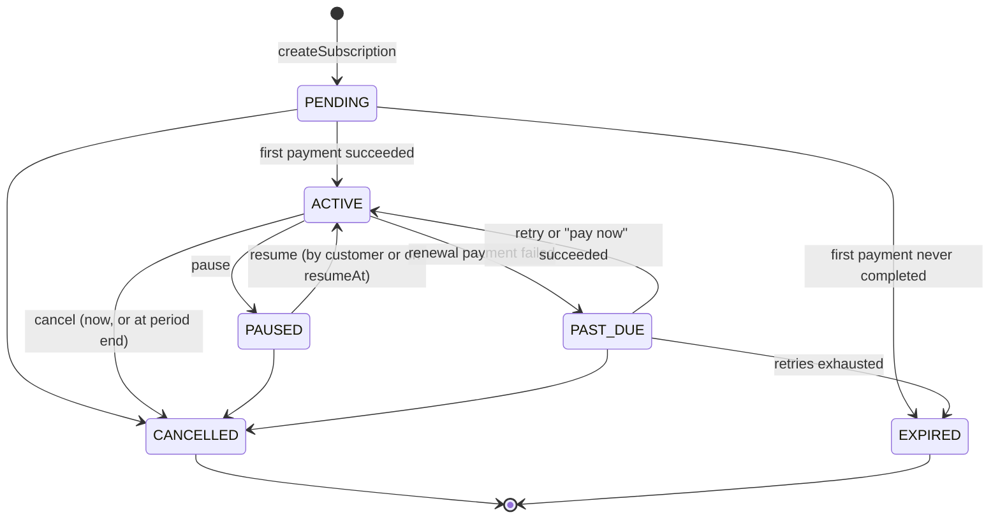
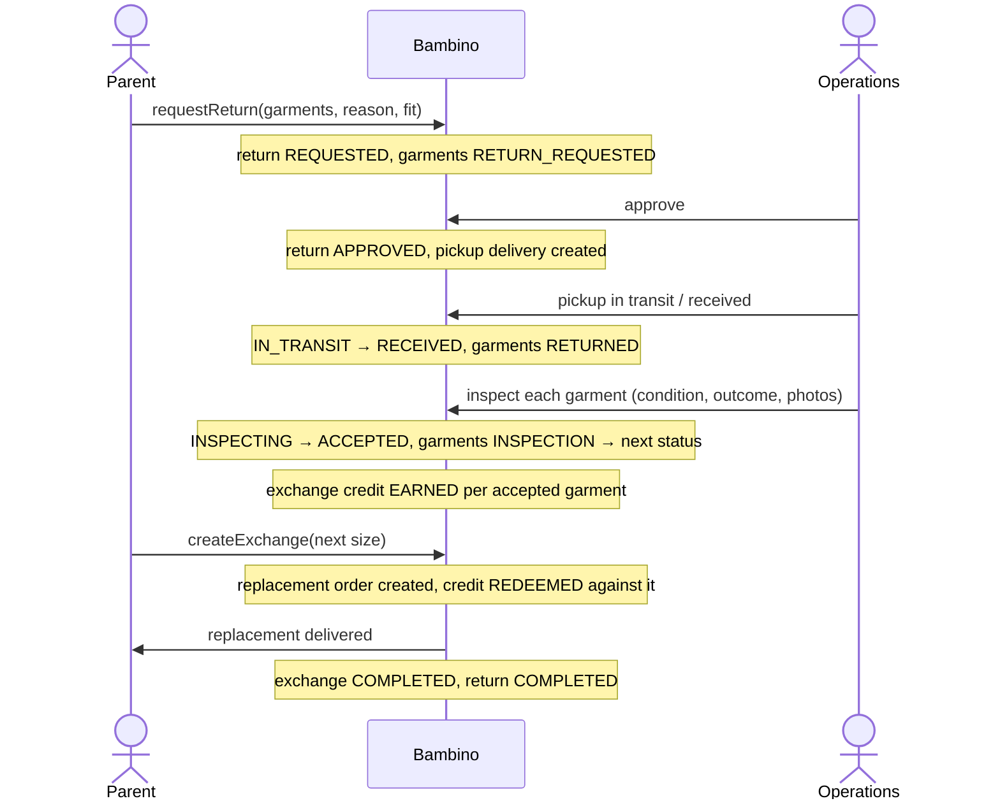
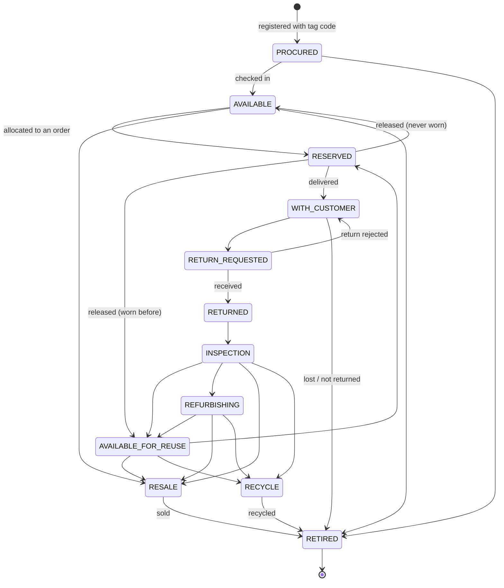

# 5. Lifecycles and the sizing engine

Every status change goes through a state machine in `apps/api/src/domain/lifecycles.ts`. A service calls
`assertTransition(from, to)` before writing; an illegal move raises `INVALID_STATE_TRANSITION` and nothing is
persisted. The tables below are the transition tables in that file, and `lifecycles.test.ts` checks them.

## 5.1 Subscription



- **Start:** creates a `PENDING` subscription and its first `SUBSCRIPTION_CYCLE` order. The status changes only
  when that order's payment is confirmed by the provider. Nothing sets `ACTIVE` directly.
- **Renewal:** when the period ends the subscription becomes `PAST_DUE` with a renewal order (event `RENEWAL_DUE`); paying it returns it to `ACTIVE` for a new period. A saved wallet is asked automatically (up to 3 times, 24 hours apart); after a 7-day grace period the renewal order is cancelled and the subscription `EXPIRED`. A reminder is sent 3 days before renewal. The job finds `ACTIVE` subscriptions with `next_billing_at` due (partial index), creates the
  next cycle's order and requests payment. See [payments §4.4](04-payments.md#44-recurring-billing-with-mobile-money).
- **Plan changes** (up or down) are stored in `pending_plan_id` and applied at the next renewal, which is then priced on the new plan.
  This is a placeholder until the proration rule is decided ([open question 6](08-open-questions.md)).
- **Cancel** defaults to `cancel_at_period_end`; the status changes when the period ends. Garments still held
  are expected back; see the open question on unreturned garments.
- **History:** every change writes a `subscription_events` row (append-only).
- The GraphQL type exposes `canPause`, `canResume` and `canCancel`, computed from this machine, so clients do
  not re-implement it.

## 5.2 Order and delivery

```
PENDING_PAYMENT → PAID → PROCESSING → PACKED → READY_FOR_DISPATCH → OUT_FOR_DELIVERY → DELIVERED
      ↓             ↓         ↓          ↓             ↓                     ↓ (failed attempt)
  CANCELLED     CANCELLED  CANCELLED  CANCELLED    CANCELLED          READY_FOR_DISPATCH

DELIVERED → RETURN_REQUESTED → RETURNED          (rejected return: RETURN_REQUESTED → DELIVERED)
```

Delivery, one per shipment or pickup:

```
PENDING → ASSIGNED → PICKED_UP → IN_TRANSIT → DELIVERED
   ↓          ↓                       ↓
CANCELLED  CANCELLED                FAILED → ASSIGNED (re-attempt) | CANCELLED
```

The delivery provider abstraction updates delivery status; the order service moves the order in step
(`OUT_FOR_DELIVERY` when the delivery is in transit, `DELIVERED` when it is delivered).

## 5.3 Return and exchange



Return: `REQUESTED → APPROVED → (IN_TRANSIT) → RECEIVED → INSPECTING → ACCEPTED → (REFURBISHING) → COMPLETED`,
with `REJECTED` possible at the request and at inspection. A return cannot be accepted without an
inspection, in the state machine and in a database CHECK.

Exchange: `REQUESTED → APPROVED → FULFILLING → COMPLETED`, with `REJECTED` and `CANCELLED`.

**Exchange credit.** Earned once per accepted garment (database-enforced). The amount comes from a pure
function `calculateExchangeCredit(condition, garmentValue, policy)` in the domain layer, whose percentages
per condition are configuration, not code. The values are a business decision still to be made
([open questions](08-open-questions.md)). Credit is spent with `applyExchangeCredit`: the server applies the
lesser of balance and amount due and re-totals the order.

## 5.4 Garment



- `AVAILABLE` means new and never worn; `AVAILABLE_FOR_REUSE` means it passed inspection after at least one
  customer. A garment cannot be reused without passing inspection.
- `GarmentLifecycleService.transition(garmentId, to, { condition, actor, metadata })` locks the garment row,
  checks the machine, updates status and condition, and appends a `garment_lifecycle_events` row, in one
  transaction. `lifecycle_count` increases when a return is accepted.
- Garments are never deleted (trigger) and events are never edited (trigger).
- These events feed the circular-economy metrics: returned, refurbished, reused, recycled and average cycles
  per garment, all counted from real rows.

## 5.5 Payment

`INITIATED → PENDING → SUCCEEDED → REFUNDED`, with `FAILED`, `CANCELLED` and `EXPIRED` as final outcomes.
There is no path from `INITIATED` to `SUCCEEDED` and no path out of a failure. See [04-payments.md](04-payments.md).

## 5.6 Sizing engine

The MVP engine is deterministic rules. It is described to customers as "size recommendation", the
`provider` field is returned with every result, and nothing in the product claims a trained model.

```
SizingService                      (application service: loads data, stores inputs + result, emits event)
   └── SizingProvider interface    recommend(input) → { size, nextSize, confidence, reasons[] }
         ├── RulesBasedSizingProvider     MVP, reads ranges from the `sizes` table
         └── MLSizingProvider             later, same interface, no client changes
```

Rules (implemented and unit-tested in Phase 5):

1. Candidate size from height when known, else weight, else age, using each size's ranges in `sizes`.
2. If height and weight point to different sizes, take the larger and lower confidence.
3. Fit preference shifts within range: `ROOMY` rounds up near a boundary, `SNUG` rounds down.
4. History: two or more `TOO_SMALL` returns at a size move the recommendation up one size.
5. Next size: the following size, with an estimated date from the baby's growth between measurements, when
   there are at least two measurements.
6. Confidence starts from the number of agreeing signals and drops for stale measurements (older than 30
   days) or age-only input. It is reported as a number; the UI shows it in words ("we're fairly sure").
7. Reasons are translation keys with parameters (`sizing.reason.height_in_range`, `{ size: "6-9M" }`).

Each call stores a `sizing_recommendations` row plus a frozen `sizing_measurements` copy of its inputs, and
fit feedback (from parents, or from return reasons) lands in `sizing_feedback`. That pairing of input and
outcome is what a future ML provider would be trained and evaluated on.
