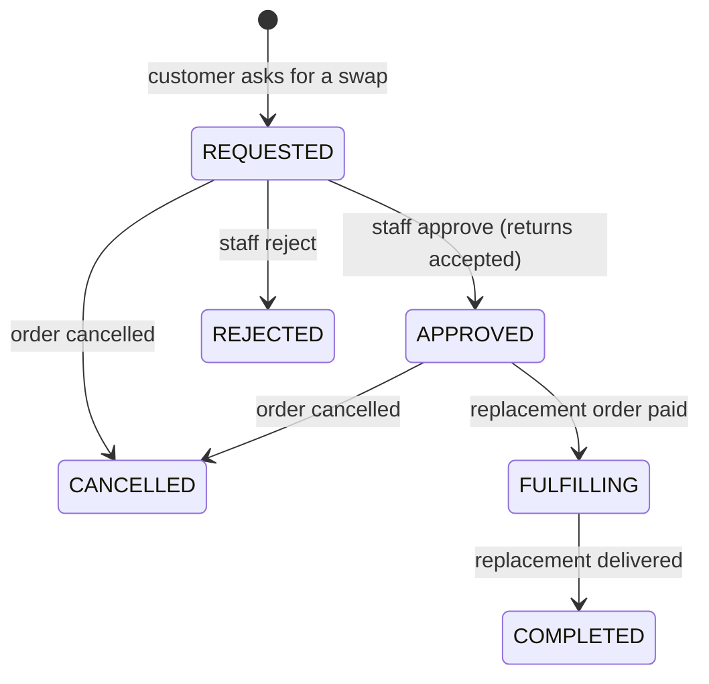

# 12. Plans, entitlements and exchanges

What a plan promises, how it is billed, and how a swap moves through the system. Every rule below names where it is
enforced, so a promise on a screen can be traced to the code behind it. The values marked **placeholder** are chosen
to be unambiguous, not decided by the business: they live in `packages/config/src/policies.ts` and are listed as open
question 16 in [08](08-open-questions.md).

## 12.1 Definitions

| Term                | Meaning                                                                                                                                                            | Where it is fixed                                                 |
| ------------------- | ------------------------------------------------------------------------------------------------------------------------------------------------------------------ | ----------------------------------------------------------------- |
| **Billing period**  | The time one payment covers: a month, three months or a year, from the plan's billing interval. The subscription's `currentPeriodStart` to `currentPeriodEnd`.     | `subscriptions` table; renewal job                                |
| **Box**             | `itemsPerCycle`: the most garments the customer holds **at one time**, chosen at the start of each billing period. It is not a count "per year" or "per delivery". | `PLAN_ENTITLEMENT_POLICY.boxMeaning`; `selectItems` refuses more  |
| **Swap** (exchange) | **One garment sent back and one other garment sent to you.** The allowance counts garments, not requests: swapping three garments in one request uses three swaps. | `PLAN_ENTITLEMENT_POLICY.exchangeUnit`; `ExchangeService.create`  |
| **Allowance**       | Swaps included per billing period (`exchangesPerCycle`); `null` means unlimited. It restarts at each renewal. Unused swaps do not carry over.                      | `PLAN_ENTITLEMENT_POLICY`; counted by `ExchangeService.swapsUsed` |
| **Included swap**   | Within the allowance the replacement garment costs nothing extra. The delivery fee still applies. Beyond the allowance a swap is refused.                          | `PLAN_ENTITLEMENT_POLICY.replacementPrice`; `resolveEntitlement`  |

Rejected and cancelled exchanges give their swaps back. Swaps are available only while the subscription is `ACTIVE`
(not paused, overdue or ended). A garment the customer **bought** is not rented, so swapping it uses no allowance and
is priced at the catalogue price.

## 12.2 The ambiguities in the three placeholder plans

The plans page shows three placeholder plans. Read with the definitions above:

| Plan      | Price (placeholder)   | Box (held at one time) | Swaps       | What it means                                                                                                      |
| --------- | --------------------- | ---------------------- | ----------- | ------------------------------------------------------------------------------------------------------------------ |
| Monthly   | RF 39,000 / month     | 5 garments             | 5 per month | Up to 5 swaps each month; the count restarts at each monthly renewal                                               |
| Quarterly | RF 108,000 / 3 months | 5 garments             | unlimited   | The box stays at 5; swap as often as needed                                                                        |
| Annual    | RF 400,000 / year     | 6 garments             | unlimited   | The box is 6 garments held at a time **for the year**, swapped as the baby grows; it is not 6 garments once a year |

Why "unlimited" on the longer plans: a limited allowance is counted per billing period, so a limited allowance on an
annual plan would be one allowance for twelve months. If the business wants "5 swaps a month" on a yearly plan, the
allowance period would have to be decoupled from the billing period, which is a larger change (open question 16).

Answers to the questions this section was written to settle:

- **What is an exchange?** One garment returned and one other received.
- **Does the allowance reset?** Yes, at the start of each billing period. Unused swaps do not carry over.
- **Does the annual plan give six garments once per year?** No: six held at a time, for the whole year.

## 12.3 Billing rules

What a customer is told before subscribing is generated from these same values (`planTerms` in
`packages/config/src/plan-terms.ts`, shown on the plan card, the subscribe step and in the mobile app).

| Rule                | How it works today                                                                                                                                                                                                                                                                                                                      | Enforced by                                           |
| ------------------- | --------------------------------------------------------------------------------------------------------------------------------------------------------------------------------------------------------------------------------------------------------------------------------------------------------------------------------------- | ----------------------------------------------------- |
| Amount and interval | The plan's price per interval, agreed at subscribe and at each renewal (`subscriptions.priceAmount`), so later price edits do not rewrite history.                                                                                                                                                                                      | `SubscriptionService`                                 |
| Renewal             | Runs every interval until cancelled. A reminder goes out `reminderDaysBeforeRenewal` days ahead. With a saved wallet the payment request is sent automatically; the customer approves it on their phone with a PIN. Without a saved wallet the customer pays the renewal order from their account.                                      | `runRenewals`; `SUBSCRIPTION_POLICY`                  |
| Next payment        | `nextBillingAt`, shown on the subscription page and in the app.                                                                                                                                                                                                                                                                         | `subscriptions.nextBillingAt`                         |
| Failed payment      | When a renewal falls due the subscription becomes `PAST_DUE` and the renewal order is created. With a saved wallet, up to `maxRenewalAttempts` payment requests follow, `hoursBetweenRenewalAttempts` hours apart. `renewalGraceDays` after the renewal date, if still unpaid, it becomes `EXPIRED` and the renewal order is cancelled. | `runRenewals`; `SUBSCRIPTION_POLICY`; lifecycle table |
| Pausing             | Up to `maxPauseDays`. Paused time is added to the period and to the next billing date, so no paid days are lost.                                                                                                                                                                                                                        | `pause` and `resumeLocked`                            |
| Changing plan       | Takes effect at the next renewal (no proration).                                                                                                                                                                                                                                                                                        | `SUBSCRIPTION_POLICY.planChangeTiming`                |
| Cancelling          | By default the plan runs to the end of the paid period and then stops, with no further charge. An unpaid or paused subscription ends immediately.                                                                                                                                                                                       | `cancelLocked`                                        |
| Refunds             | Subscription payments are not refunded (only one-time shop orders can be cancelled with a refund). **Placeholder** (open question 13).                                                                                                                                                                                                  | `REFUND_POLICY.cancellableOrderTypes`                 |
| Delivery fees       | Charged separately with each period (each renewal order carries the delivery fee of the option chosen at subscribe). Not part of the plan price.                                                                                                                                                                                        | `createCycleOrder`; delivery options                  |
| Taxes               | The market's rule: Rwanda has none configured, so no tax is added. If a rule is added the terms text changes with it (included or added at checkout).                                                                                                                                                                                   | `getMarket(...).tax`; open question 7                 |
| Exchange fees       | None within the allowance (the delivery fee applies). Beyond the allowance a swap is refused, not charged.                                                                                                                                                                                                                              | `PLAN_ENTITLEMENT_POLICY`                             |

## 12.4 The exchange workflow

Your five steps map onto two linked state machines, the **return** (the garment coming back) and the **exchange** (the
replacement going out). Both are checked on the server on every transition (`assertTransition`), updated with the
expected current status in the `WHERE` clause (a second writer gets `STALE_EXCHANGE`), and audited.

| Step                            | Return status                             | Exchange status          | What the server checks                                                                                                                                                        |
| ------------------------------- | ----------------------------------------- | ------------------------ | ----------------------------------------------------------------------------------------------------------------------------------------------------------------------------- |
| 1. Exchange requested           | `REQUESTED`                               | `REQUESTED`              | Ownership of the returned garments; the subscription is `ACTIVE`; swaps left in this period; replacement stock reserved; idempotency key; one exchange per returned garment   |
| 2. Pickup scheduled             | `APPROVED` (a pickup delivery is created) | `REQUESTED`              | One open pickup per return (database constraint)                                                                                                                              |
| 3. Items received and inspected | `RECEIVED`, `INSPECTING`, then `ACCEPTED` | `REQUESTED`              | Inspection records condition and credit; credit is earned once per garment (database constraint)                                                                              |
| 4. Replacement allocated        | `ACCEPTED`                                | `APPROVED`, `FULFILLING` | **Approval is refused until every returned garment is `ACCEPTED`** (`RETURN_NOT_ACCEPTED`). Shipping follows payment of the delivery fee, or is immediate when nothing is due |
| 5. Exchange completed           | `COMPLETED`                               | `COMPLETED`              | Set when the replacement order is delivered; customer notified; analytics event; audit trail kept                                                                             |

Alternative endings: staff reject the exchange (`REJECTED`, frees the reserved garments, returns credit and gives the
swap back) or the replacement order is cancelled (`CANCELLED`).

One deliberate difference from the order in your list: the replacement garment is **reserved at the request**, not after
inspection. That keeps the customer's promise (the size they chose is held for them) at the cost of holding stock
while the old garment is on its way back. Staff approval, and therefore shipping, still waits for inspection. If stock
pressure makes this wrong, the reservation can move to approval; the checks are already in place.

## 12.5 Duplicate protection

| Duplicate                                    | Prevented by                                                                                                         | Tested in                   |
| -------------------------------------------- | -------------------------------------------------------------------------------------------------------------------- | --------------------------- |
| The same request sent twice                  | Idempotency key on the replacement order; the second call returns the first exchange. One order, one swap used.      | `plan-entitlements.test.ts` |
| Two exchanges for one returned garment       | Unique index `exchange_items_return_item_uq`; `RETURN_ITEM_ALREADY_EXCHANGED`                                        | `plan-entitlements.test.ts` |
| More than one replacement order per exchange | Unique index `exchanges_replacement_order_uq`; one order is created inside the same transaction                      | `circular.test.ts`          |
| Duplicate credit for a returned garment      | Partial unique index `exchange_credits_one_earning_per_return_item_uq`                                               | `circular.test.ts`          |
| Credit spent twice on one order              | Partial unique index `exchange_credits_one_redemption_per_order_uq`                                                  | `circular.test.ts`          |
| Duplicate pickups for one return             | Partial unique index `deliveries_one_open_pickup_per_return_uq` (a failed or cancelled run does not block a new one) | `plan-entitlements.test.ts` |
| Approving twice, or out of order             | `assertTransition` plus the status in the `WHERE` clause                                                             | `plan-entitlements.test.ts` |
| Spending the last swap twice at once         | The customer row and the subscription row are locked for the whole request; the count is taken inside the lock       | by construction             |

## 12.6 Still to decide (open question 16)

1. Confirm the definitions in 12.1, in particular that an annual plan's box is "held at a time", and whether a limited
   allowance on a long plan should be counted per month instead of per billing period.
2. Whether swaps should be allowed while a subscription is overdue (`PAST_DUE`), and whether holding late garments
   should block new swaps.
3. Whether unused swaps should carry over, and whether swaps beyond the allowance should be sold instead of refused.
4. Whether a cancelled subscription is refunded for the unused part of a period (open question 13).
5. What exchange credit is for once swaps are included: today it offsets the delivery fee and shop purchases.
6. Real prices, and the real allowance for each plan (open questions 1, 5 and 9).
7. Concurrency relies on row locks. `plan-entitlements.test.ts` fires four simultaneous requests at the last swap and checks that exactly one wins; with the in-process test database queries are serialised, so the locks across real connections have not been exercised yet. Run it once against PostgreSQL (`TEST_DATABASE_URL=... pnpm --filter @bambino/api test plan-entitlements`) before launch.
